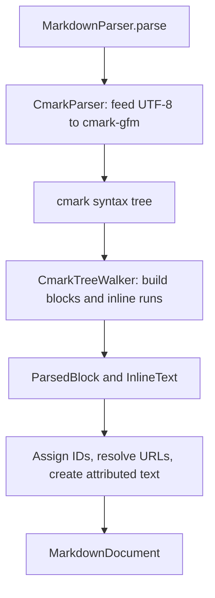

# MEGAMarkdown architecture

This guide is the overview of the package. It names each layer, its public contract, and where the details live. The model, parser, and internal chunking layers are implemented. Sections marked **Coming soon** outline future responsibilities; their APIs and implementation decisions will be filled in with the corresponding changes.

Each implemented layer has a reference page with the full detail. Keep this guide short and put new detail in the reference pages.

## Package layers

| Layer | Status | Responsibility | Reference |
|---|---|---|---|
| [Document model](#public-document-model) | Implemented | Public block tree and inline attributes shared by consumers. | This guide |
| [Parser](#parsing-pipeline) | Implemented | Markdown syntax recognition, conversion, and behavior rules. | [PARSER.md](PARSER.md) |
| [Large-input support](#large-input-support) | Internal helpers implemented | Safe chunk ranges and reference-definition collection. | [CHUNKING.md](CHUNKING.md) |
| [Rendering and styling](#rendering-and-styling) | Coming soon | Inline and block presentation, themes, and user interaction. | |
| [Large-file preview](#large-file-preview) | Coming soon | Connect chunking to background parsing and visible-content presentation. | |
| [Editor model and mutations](#editor-model-and-mutations) | Coming soon | Editable state, selection, and document changes. | |
| [Markdown import and export](#markdown-import-and-export) | Coming soon | Conversion between editable content and Markdown source. | |
| [Editor UI](#editor-ui) | Coming soon | Rich/source editing modes, controls, and accessibility. | |
| [App integration](#app-integration) | Coming soon | File lifecycle, navigation, saving, and host-provided behavior. | |

## Public document model

[MarkdownDocument.swift](Sources/MEGAMarkdown/Model/MarkdownDocument.swift) defines the public value tree. The types conform to `Equatable` and `Sendable`, so callers can compare results and pass them from parsing work to a consumer.

| Type | Responsibility |
|---|---|
| `MarkdownDocument` | Holds the top-level blocks in document order. |
| `MarkdownBlock` | Holds an ID, source line, and block kind. Kinds include headings, paragraphs, lists, code blocks, quotes, tables, thematic breaks, and images. |
| `MarkdownList` / `MarkdownListItem` | Keep ordering, the starting number, optional task-checkbox state, and child blocks. |
| `MarkdownTable` | Holds column alignment, header cells, and body rows. Cell text is an `AttributedString`. |

The parser produces these contracts:

- Block IDs start at zero and follow depth-first order, with each parent before its children. They are unique within a parsed document and are reassigned on every parse; they do not identify the same content across edits.
- Source lines are zero-based. They come from cmark positions, with fallbacks for nodes that report no position. Containers such as lists and quotes use the first retained content's line. These are navigation hints, not complete source ranges.
- Headings and paragraphs carry inline attributes in `AttributedString`. Block structure lives in the tree; inline text has no Foundation block presentation intent or Markdown source-position attributes.
- Ordered lists retain their starting number, adjusted when leading empty items are dropped. Bullet lists start at one.
- Each table row has the header's column count. Missing cells are padded and extra cells are dropped. Entirely empty body rows are omitted.
- Code blocks contain literal code without trailing newlines. The optional language field carries cmark's fence-info string.

This is a semantic model. A consumer that needs the original Markdown spelling, whitespace, or exact edit ranges must also retain the source.

## Parsing pipeline

[MarkdownParser.parse](Sources/MEGAMarkdown/Parsing/MarkdownParser.swift) turns a source string into a `MarkdownDocument`. It takes an optional base URL for relative links and a soft-break mode. It is synchronous, parses the whole input, and can run off the main thread.



- cmark-gfm owns syntax recognition. The pinned version is a behavior contract.
- The tree walker builds blocks from enter/exit events without recursion, with a nesting limit of 64.
- Inline text stays in a compact form until the final conversion to `AttributedString`.
- The conversion keeps established Foundation `AttributedString(markdown:)` behavior where intended.

[PARSER.md](PARSER.md) has the API example, the walker state, the compact text model, the full table of behavior decisions, and the parser test map.

## Large-input support

[MarkdownChunker.swift](Sources/MEGAMarkdown/Parsing/MarkdownChunker.swift) cuts a large input into chunks. Each chunk parses to the same tree as the whole file would give for that range, so one cmark tree at a time is enough. The chunker only cuts where a cmark probe confirms the last block is closed. It also collects link reference definitions from all chunks and shares them, so a reference can point to a later chunk.

The helper is internal and has no production caller. `MarkdownParser.parse` always parses the whole input.

[CHUNKING.md](CHUNKING.md) explains why chunks are needed, the cut rules, the definition prefix, and how a consumer should drive the chunker.

## Rendering and styling

**Coming soon.** This section will describe how document blocks and inline attributes become views, including inline-only text, lists, tables, code, quotes, and images. It will cover theme values, environment propagation, link/image interaction, localization, Dynamic Type, and accessibility. Add the public view APIs and model-to-view diagram when the renderer lands.

## Large-file preview

**Coming soon.** The chunking helpers above still need a consumer. This section will describe file loading, background parsing, reference-definition discovery, cancellation and stale-result handling, visible-content conversion, and loading/error/plain-text states. Document which objects retain the source and parsed blocks, and how the preview uses source lines for navigation.

## Editor model and mutations

**Coming soon.** This section will define ownership of editable state, block and text identity during edits, selection, formatting operations, and undo/redo. Explain how editable state relates to `MarkdownDocument`, whose parser-assigned IDs are recreated on every parse. Add mutation examples and invariants with the implementation.

## Markdown import and export

**Coming soon.** This section will describe conversion between Markdown source and the editor model, supported round trips, normalization, and handling of unsupported syntax. Document rules for whitespace, escaping, links/images, HTML styles, and soft/hard breaks alongside focused round-trip tests.

## Editor UI

**Coming soon.** This section will describe rich and source editing modes, bindings and callbacks, text-system integration, keyboard and selection behavior, formatting controls, and mode transitions. Include localization, accessibility, focus, and text input behavior as the UI is implemented.

## App integration

**Coming soon.** This section will explain how the host app loads and saves files, presents previews and editors, supplies themes and localized strings, and handles links and image resources. Document lifecycle and error handling at the package boundary, with a minimal integration example once an app flow uses the package.

## Testing

The tests use Swift Testing and are included in the repository's [MEGAModulesTests plan](../../../MEGAModulesTests/MEGAModulesTests.xctestplan). Each reference page lists the tests for its layer: [parser tests](PARSER.md#tests-for-this-layer) and [chunking tests](CHUNKING.md#tests-for-this-layer).

### Running tests

Open `Package.swift` in Xcode, choose the `MEGAMarkdown` scheme and an installed iOS simulator, then run tests. From the package directory, the equivalent command is:

```sh
xcodebuild test \
  -scheme MEGAMarkdown \
  -destination 'platform=iOS Simulator,id=<SIMULATOR_UDID>' \
  -skipPackagePluginValidation
```

Replace `<SIMULATOR_UDID>` with an available simulator ID from `xcrun simctl list devices available`.

For optional runs, export these variables before invoking `xcodebuild`. The `TEST_RUNNER_` prefix passes them into the test process; setting an arbitrary Xcode build setting is not equivalent.

| Exported variable | Effect |
|---|---|
| `TEST_RUNNER_MARKDOWN_BENCH=1` | Enables the serialized time, memory, and scaling benchmarks. Check that they ran rather than being skipped. |
| `TEST_RUNNER_MARKDOWN_FUZZ_ITERATIONS=400` | Sets the seeded fuzz iteration count for the snippet fuzz and the spec-example fuzz; 400 is the default, with three chunk targets per iteration. |
| `TEST_RUNNER_MARKDOWN_CHUNK_FILES=/absolute/a.md:/absolute/b.md` | Enables whole-versus-chunked comparison for additional files. |
| `TEST_RUNNER_MARKDOWN_REFERENCE_ITERATIONS=3000` | Sets the number of seeded mutations in the cmark comparison. 3,000 is the default. |
| `TEST_RUNNER_MARKDOWN_REFERENCE_SEED=11` | Sets the seed of those mutations. 11 is the default. |
| `TEST_RUNNER_MARKDOWN_REFERENCE_REPORT=/absolute/report.txt` | Writes every difference from cmark to the file, with both sides. |
| `TEST_RUNNER_MARKDOWN_REFERENCE_FILES=/absolute/a.md:/absolute/b.md` | Compares additional files with cmark, for example real documents or another parser's test inputs. |
| `TEST_RUNNER_MARKDOWN_FOUNDATION_PARITY=1` | Enables the comparison with Foundation's `AttributedString(markdown:)`. Foundation is not a source of truth, and its output changes with the OS. |

Report benchmark results with the input, build configuration, simulator/device, and measured operation.

### Updating golden output

For an intentional output change, set `TEST_RUNNER_MARKDOWN_WRITE_GOLDENS` to the absolute path of `Tests/MEGAMarkdownTests/Fixtures/golden` and run the golden tests (`ParserGoldenTests` and `SpecCorpusGoldenTests`). Write mode records a test issue deliberately. Review the changed snapshots, unset the variable, and rerun in comparison mode. Include a focused behavior test when the change introduces a new contract.

## Extending the guide

Update this guide in the same MR that adds or changes an implementation layer. Replace the relevant **Coming soon** text with a short summary of the APIs, data flow, and limitations, then update the layer's status above. Put the full detail in a reference page next to this guide and link it from the layers table.

Keep unimplemented responsibilities clearly marked; a placeholder does not commit to a particular UI framework or state-management design. The README remains the package entry point, while this guide explains the implementation and the remaining layers.
