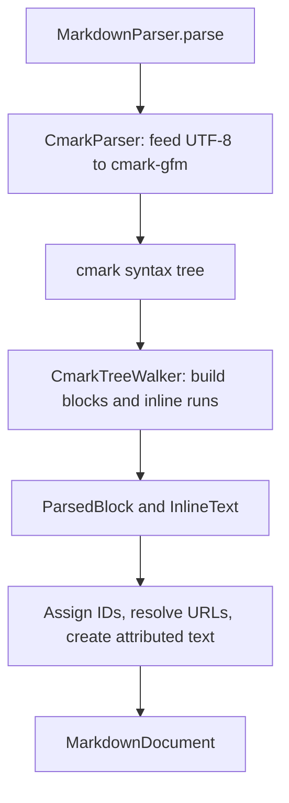

# MEGAMarkdown parser reference

How Markdown text becomes a `MarkdownDocument`. This is the detail page for the parser layer.
The [architecture guide](ARCHITECTURE.md) gives the overview. Chunking of large input has its own
page: [CHUNKING.md](CHUNKING.md).

## Parsing API

[MarkdownParser.parse](Sources/MEGAMarkdown/Parsing/MarkdownParser.swift) accepts a source string, an optional base URL, and a soft-break mode:

```swift
import Foundation
import MEGAMarkdown

let document = MarkdownParser.parse(
    "# Release notes\n\n- [x] **Ship parser**\n\n[Guide](guide.md)",
    baseURL: URL(string: "https://mega.io/docs/"),
    softBreak: .lineBreak
)
```

The example produces a heading, a list with one checked item and a bold paragraph, and a linked paragraph. The relative link resolves against the supplied base URL.

| Property | Behavior |
|---|---|
| Threading | The API is synchronous and uses state local to each parse. It can run off the main thread. The caller chooses where to execute it. |
| Scope | It parses the entire input. It converts all inline text into `AttributedString` before returning. It does not use the chunker. |
| Soft breaks | The default mode keeps a single newline inside a paragraph. `.space` displays that break as a space. Both modes keep a `.softBreak` attribute. Explicit hard breaks keep `.lineBreak`. A consumer can tell them apart even when both display as newlines. |
| Failure | If cmark cannot create a parser or finish its tree, the API logs a warning and returns the raw input as one plain paragraph. |
| Empty input | Empty or whitespace-only Markdown produces no blocks. |

## Pipeline



### cmark owns syntax recognition

[CmarkParser.swift](Sources/MEGAMarkdown/Parsing/CmarkParser.swift) creates a cmark parser with source positions and attaches the table, strikethrough, autolink, and tasklist extensions. The walker reads each task marker from the source bytes, using the rules in [Behavior decisions](#behavior-decisions).

The parser accepts an optional prefix and a UTF-8 body. Ordinary parsing uses an empty prefix. Chunked parsing can prepend reference-link definitions (see [CHUNKING.md](CHUNKING.md)). The syntax tree is walked inside a closure. A `defer` frees the C parser and tree before the call returns.

The cmark dependency is pinned in [Package.swift](Package.swift). An upgrade can change parsing behavior. Its output must be reviewed against the fixtures and regression tests. The copied cmark spec files in [Fixtures/cmark-spec](Tests/MEGAMarkdownTests/Fixtures/cmark-spec/NOTICE.md) must come from the same revision. The `REVISION` file in that folder records the commit they were copied from. [SpecCorpusRevisionTests.swift](Tests/MEGAMarkdownTests/SpecCorpusRevisionTests.swift) compares it with the swift-cmark pin in `Package.resolved` and fails after a pin bump. [scripts/refresh-cmark-spec.sh](scripts/refresh-cmark-spec.sh) downloads the files for the pinned revision and rewrites `REVISION`.

### The walker builds blocks from enter/exit events

[CmarkTreeWalker.swift](Sources/MEGAMarkdown/Parsing/CmarkTreeWalker.swift) uses `cmark_iter` to walk the tree without recursive Swift traversal. It separates state into:

| State | How it is used |
|---|---|
| Container frames | Accumulate children for the document, quotes, lists, items, tables, and rows. Exiting a container finishes it and attaches it to its parent. |
| Inline contexts | Inherit the active style, link, and image state. Entering emphasis or a link pushes a context. Exiting restores the previous context. |
| Inline pieces | Collect text and its context inside one paragraph, heading, or table cell before style-tag processing. |
| Push bookkeeping | Records whether each entered container opened a frame. This keeps exit events balanced when the nesting limit is reached. |

These structures live in [CmarkTreeWalker+State.swift](Sources/MEGAMarkdown/Parsing/CmarkTreeWalker+State.swift). Quotes and list items count towards a nesting limit of 64. Beyond that limit, the walker stops opening those containers. It places their content in the deepest retained container. This also bounds the model depth used by the later recursive conversion.

For `- [x] **Ship parser**`, cmark's `tasklist` extension marks the list item as a task and removes the marker from the text. The walker reads `[x]` at the item's source position, so the item is checked. Bold stays on `Ship parser`.

The walker takes a `lineOffset`. It adds the offset to every cmark line. A whole parse uses zero. A chunked parse uses it to turn chunk-relative lines into document lines.

### Compact text delays attributed-string allocation

[ParsedBlock.swift](Sources/MEGAMarkdown/Parsing/ParsedBlock.swift) mirrors the public block structure. It uses [InlineText](Sources/MEGAMarkdown/Parsing/InlineText.swift) for text. An `InlineText` stores a string, compact style runs ending at UTF-8 offsets, and link/image targets. Plain text needs no stored run array. Adjacent runs with the same style and target merge.

This keeps intermediate results cheaper than building attributed strings during traversal. The public API converts the whole result. A preview consumer can convert only the content it needs.

During conversion, `ParsedBlock.markdownBlock` assigns IDs. `InlineText.attributed` creates inline attributes and resolves URLs. `InlineLink.makeURL` percent-encodes every byte outside RFC 3986 first. The host after `scheme://` or a leading `//` stays as written, so Foundation can turn a non-ASCII host into punycode. A valid `%xx` escape stays as it is. A `[` or `]` outside an IPv6 host is encoded too. A relative path with `:` in its first segment gets `./` in front, so `foo):` stays a path. Link titles become alternate descriptions. No C node pointers escape into either Swift model.

`ParsedTable` also stores the source line of each retained body row. Dropping an empty row leaves a gap in those lines. So a row index cannot replace a source line. This metadata is internal. Public `MarkdownTable` contains only columns and cell text.

## Behavior decisions

The conversion gives cmark's HTML output, except for the intended differences in [DECISIONS.md](DECISIONS.md#intended-differences-from-cmark) and the task rules. [CmarkTreeWalker+Rules.swift](Sources/MEGAMarkdown/Parsing/CmarkTreeWalker+Rules.swift) contains shared conversion rules. The walker also handles block-specific decisions.

| Input or feature | Result |
|---|---|
| Task items | `[ ]`, `[x]`, or `[X]` right after the list marker, followed by a space or tab on the same line, sets the checkbox. The state comes from that marker only, so a later `[x]` on the line does not check the item. cmark's `tasklist` extension finds the marker when the line starts with the item's list marker. Inside a quote (`> - [x] a`) or after a second list marker (`- - [x] a`) it does not, so the walker reads the marker at the start of the item's first paragraph. Both read the source bytes, so an escaped `\[x]` or an entity `&#91;x&#93;` stays literal text. The spaces after the marker are removed. A space written as `&#32;` stays. A marker alone on its line is text. An item with a marker and nothing else keeps its checkbox and an empty paragraph. |
| Inline HTML styles | Matched bare tags for bold, italic, strike, code, and underline apply styles and are removed. Supported names and pair matching live in [StyleTag.swift](Sources/MEGAMarkdown/Parsing/StyleTag.swift). Unmatched or unsupported tags remain literal. |
| HTML blocks | Preserved as raw paragraph text with `.blockHTML`. This layer does not render them as HTML. |
| Empty constructs | Empty headings, contentless quotes/list items, and empty table body rows are dropped. A code block with an empty cmark literal is dropped. |
| Table alignment | An unspecified alignment becomes `.left`, matching the established output. |
| Images | A paragraph containing only images becomes one image block. It uses the first image's URL and the collected alt text. Images mixed with other text stay inline. |
| Empty image alt text | An internal `U+FFFC` placeholder keeps the image present during traversal. Image blocks expose an empty alt string. Inline images retain the placeholder. An image inside a link keeps the link on its alt text or on the placeholder. Nothing inside alt text adds a placeholder. |
| Breaks inside image alt text | Inner formatting is omitted from the alt text. A line break becomes a space, like cmark writes it. |

[ParserDifferenceTests.swift](Tests/MEGAMarkdownTests/ParserDifferenceTests.swift) records deliberate differences and difficult inputs: multiline link labels retain their break, empty image blocks expose empty alt text, selected missing source positions are repaired, and deep nesting is bounded. A paragraph interrupted by a table can still share the table's reported starting line. Positions are not an exact source map.

## Tests for this layer

| Coverage | Where to read |
|---|---|
| Block kinds, inline styles, nesting, tables, and source positions | `ParsingBlockTests`, `ParsingInlineTests`, `ParsingNestingTests`, and `ParsingTableTests`. |
| Break attributes, underline, HTML style tags, and compact text | `ParsingSoftBreakUnderlineTests`, `ParsingStyleTagTests`, and `InlineTextTests`. |
| Same output as cmark | [CmarkReferenceTests.swift](Tests/MEGAMarkdownTests/CmarkReferenceTests.swift) renders the parser output as HTML and compares it with cmark's own HTML for the same input. It runs every spec example, every fixture file, and 3,000 seeded mutations. Each intended difference is a rule in [CmarkReference.swift](Tests/MEGAMarkdownTests/CmarkReference.swift). |
| Exact public output | [ParserGoldenTests.swift](Tests/MEGAMarkdownTests/ParserGoldenTests.swift) compares 61 Markdown fixtures with checked-in text snapshots, using the default parse options. |
| Intentional differences and difficult inputs | [ParserDifferenceTests.swift](Tests/MEGAMarkdownTests/ParserDifferenceTests.swift). |
| Output for every cmark spec example | [SpecCorpusGoldenTests.swift](Tests/MEGAMarkdownTests/SpecCorpusGoldenTests.swift) parses the 742 examples in `Fixtures/cmark-spec` and compares the dump with one golden file, `cmark-spec-examples.txt`. It freezes the output. It does not prove the output is right. It shows which spec examples a change touches. |
| Pathological inputs | [PathologicalInputTests.swift](Tests/MEGAMarkdownTests/PathologicalInputTests.swift) runs the inputs from cmark's `pathological_tests.py` through the whole parser. Each case must finish in 5 seconds and give the output cmark gives. Deep quotes and lists are in `ParserDifferenceTests`. |
| Large-document structure and background parsing | [ParsingLargeInputTests.swift](Tests/MEGAMarkdownTests/ParsingLargeInputTests.swift). |

The source of truth for each parser behaviour is in [DECISIONS.md](DECISIONS.md#source-of-truth). Check a bug report with the steps in [Reporting a parser bug](DECISIONS.md#reporting-a-parser-bug). The golden snapshots are not a source of truth. They show which outputs a change touches. `SpecCorpusParityTests` compares with Foundation's `AttributedString(markdown:)` only when `MARKDOWN_FOUNDATION_PARITY=1` is set. See [Testing](ARCHITECTURE.md#testing) for how to run the tests and update golden output.
